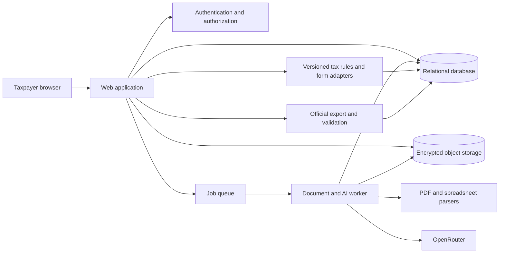
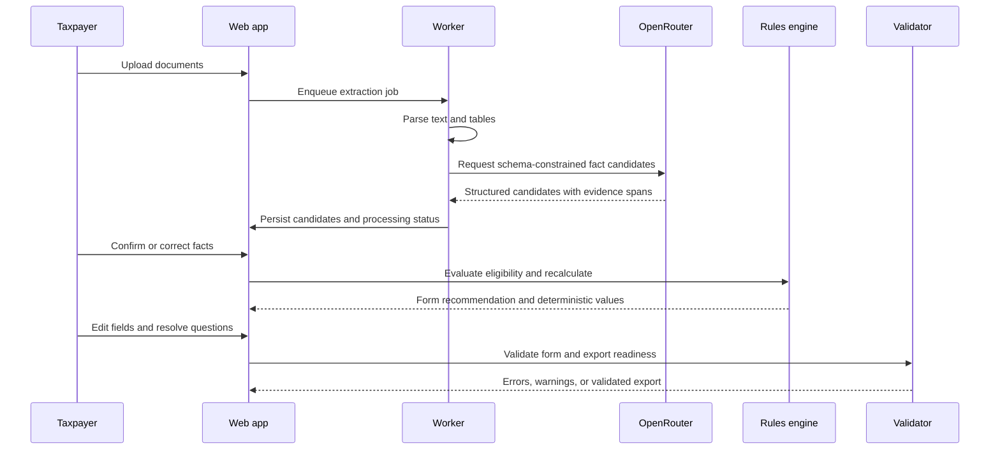
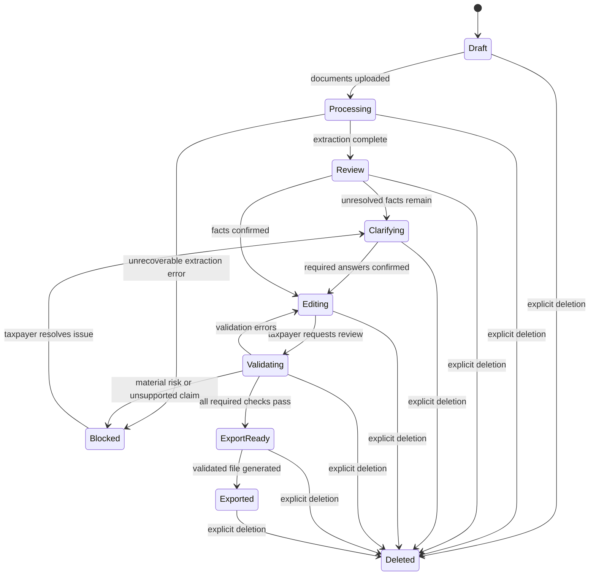

## Goal Capsule

- **Objective:** Enable an individual taxpayer to turn real financial documents into a reviewable, editable, validated Indian income-tax return without invented facts or unsupported filing claims.
- **Means:** A guided self-service filing workspace that combines evidence-linked document understanding, one-question-at-a-time clarification, synchronized official-format form editing, and deterministic tax calculations.
- **Product authority:** User-confirmed requirements in this document, with official Income Tax Department and CBDT resources as the source of truth for forms, schemas, instructions, validations, and assessment-year rules.
- **Open blockers:** The public GitHub repository must be created before implementation begins; the initial assessment-year/form surface and official machine-readable schemas must be verified during planning, and deployment credentials remain environment-specific prerequisites.

## Product Contract

### Summary

Build a production-ready, upload-first filing workspace for individual taxpayers. It should guide a taxpayer from real financial documents through evidence review, form selection, missing-information resolution, editable official-format return data, validation, and a truthful export/manual-filing workflow.

### Problem Frame

Individual taxpayers must assemble information from scattered salary, bank, investment, deduction, and tax-credit documents while also determining which ITR form and tax rules apply. Mistakes are costly, but existing workflows make it difficult to see where a value came from, which facts are confirmed, which values are calculated, and what remains unresolved.

AI can reduce the reconciliation burden only if it is constrained. The product must not invent taxpayer facts, statutory fields, calculations, or filing outcomes. Official rules and form definitions need versioning and deterministic computation, while AI is used for document interpretation, classification, explanations, and targeted questions.

The first release is for taxpayers filing their own returns. It prioritizes a safe, useful outcome even when direct government submission is unavailable: a validated official-format export, a guided manual filing path, and a clear evidence bundle for professional review when the return cannot safely proceed.

### Actors

- A1. **Individual taxpayer:** Uploads financial documents, confirms or corrects extracted facts, answers questions, edits the return, reviews risks, saves progress, and exports a validated return.
- A2. **Professional reviewer:** Reviews a taxpayer's unresolved issues and evidence bundle outside the product or through a future authorized workflow; is not a first-release collaborative actor.
- A3. **Filing rules authority:** Official Income Tax Department and CBDT publications, schemas, instructions, validation rules, and notified assessment-year materials.
- A4. **AI inference provider:** Server-side OpenRouter models used for bounded extraction, classification, explanations, and question generation; never the statutory source of truth.

### Requirements

#### Filing workspace and sessions

- R1. The product must provide persistent taxpayer accounts and independent filing sessions that can be reopened with their titles, timestamps, current status, and saved progress.
- R2. The initial experience must guide a first-time taxpayer toward uploading supported financial documents and explain what documents are useful before processing begins.
- R3. After processing starts, the workspace must support navigation/history, an AI conversation, and an editable return panel, with responsive behavior for smaller screens.
- R4. The taxpayer must be able to start a new filing session without changing or overwriting another session.

#### Documents, extraction, and evidence

- R5. The product must accept real PDF, XLS, XLSX, and CSV financial documents and show upload, processing, preview, success, and recoverable error states.
- R6. The system must extract relevant income, expenses, investments, deductions, dates, employer details, TDS, interest income, capital gains, and other supported tax information from uploaded documents.
- R7. Every material extracted fact must retain a source reference that lets the taxpayer inspect the originating document and relevant evidence on demand.
- R8. The interface must distinguish extracted facts, taxpayer-confirmed facts, computed values, and unresolved fields.
- R9. The taxpayer must be able to correct extracted facts, with corrections propagating to dependent profile data, calculations, questions, and form fields.
- R10. The product must never silently replace unavailable, ambiguous, contradictory, or unsupported information with a guess; it must mark the issue unresolved or ask the taxpayer to resolve it.

#### Form eligibility and taxpayer questions

- R11. When Auto is selected, the product must determine the eligible ITR form using the taxpayer's actual income sources, residency, eligibility conditions, exclusions, and verified assessment-year rules.
- R12. The taxpayer must be able to choose a supported ITR form manually, subject to the same official eligibility and validation checks.
- R13. The product must explain why the selected form is appropriate and identify conditions that require professional review.
- R14. The assistant must ask only for missing, ambiguous, or contradictory information and must present one question at a time.
- R15. The taxpayer must be able to review and correct answers, with resulting changes reflected in the profile, questions, calculations, and return.

#### Official return editing and calculations

- R16. The form panel must represent the verified official form surface for the selected assessment year and form, including actual field labels, sections, field types, validation rules, and applicable calculations; it must not present a generic approximation as an official replica.
- R17. Changes made in the form must remain synchronized with the conversation and underlying taxpayer data, and dependent values must recalculate immediately.
- R18. The product must calculate applicable totals, deductions, taxable income, tax liability, rebates, interest, TDS credits, refunds, and amounts payable using deterministic rules for the verified assessment year.
- R19. The product must validate required fields, field relationships, official schema constraints, and filing risks before permitting export.
- R20. The product must clearly identify unsupported forms, unavailable official definitions, unavailable rules, and unresolved calculations instead of fabricating a result.

#### Review, export, and filing truthfulness

- R21. The product must provide a review screen that highlights missing fields, inconsistencies, unsupported claims, unresolved evidence, and potential filing risks.
- R22. Export must be blocked when a material ambiguity, unresolved filing risk, unsupported claim, or required validation failure remains. A future separately authenticated reviewer workflow may clear a specifically acknowledged issue, but no taxpayer-provided professional-review flag may bypass the launch gate.
- R23. Once validation passes, the product must generate the applicable official supported export, including JSON or XML when required by the verified filing workflow.
- R24. When direct Income Tax Department submission is unavailable or unauthorized, the product must provide a validated export and a clearly explained manual filing workflow.
- R25. The product must not claim that a return was filed unless an authorized integration confirms successful submission.
- R26. When professional review is needed, the product must provide a clear issue report and downloadable evidence bundle that the taxpayer can take to their own advisor.

#### Security, privacy, and operations

- R27. OpenRouter calls must be made only from the server using environment-managed credentials; no API key may be exposed in frontend code or committed to source control.
- R28. The product must apply secure authentication, authorization, rate limiting, safe file handling, error handling, logging, and token/cost controls appropriate for taxpayer financial data.
- R29. Uploaded documents and extracted financial data must remain available until the taxpayer explicitly deletes the filing, with secure deletion of the source files and associated extracted data.
- R30. The product must provide clear loading, empty, error, retry, recovery, and irreversible-action confirmation states throughout the filing workflow.

### Key Decisions

- **Self-service taxpayer product over advisor collaboration:** The first release serves individual taxpayers filing their own returns rather than adding an advisor marketplace or shared collaboration surface.
- **Export-first filing promise:** The product remains useful without direct government submission by treating validated export and guided manual filing as the guaranteed path.
- **Deterministic statutory core:** AI assists with interpretation and communication, while form eligibility, tax rules, calculations, and validation come from verified, versioned official sources.
- **Safety gate before export:** Material unresolved issues block export until resolved or explicitly reviewed by a professional.
- **Evidence visible without overwhelming the workspace:** Source indicators appear inline, with detailed source excerpts and document context available on demand.
- **Explicit user-controlled retention:** Filing data remains available until the taxpayer deletes it rather than being automatically discarded after extraction or export.
- **Upload-first onboarding:** The first-time experience focuses on collecting and explaining useful documents before opening the full conversational/form workspace.
- **Public repository as the starting point:** Implementation will begin in a newly created public GitHub repository rather than extending an existing supplied codebase.

### Key Flows

- F1. **Start a filing:** A1 creates a new session, sees supported-document guidance, uploads one or more documents, and receives processing progress and recoverable errors.
- F2. **Verify extracted facts:** The system presents a structured taxpayer profile with concise source indicators; A1 reviews evidence, confirms or corrects facts, and sees dependent values update.
- F3. **Select the form:** Auto evaluates verified facts against the supported assessment-year rules and explains the result; A1 may choose a supported form manually, subject to eligibility checks.
- F4. **Resolve missing information:** The assistant asks the next unresolved question one at a time, records A1's answer or correction, and updates the profile and return.
- F5. **Edit and review the return:** A1 edits official-format fields in the form panel, sees immediate dependent recalculation, and reviews validation failures, inconsistencies, and filing risks.
- F6. **Complete or escalate:** If all required checks pass, A1 exports the validated return and follows the manual filing workflow when needed; otherwise the product blocks export and generates the issue/evidence bundle for professional review.
- F7. **Resume or delete:** A1 reopens saved progress later or explicitly deletes the filing, after which associated documents and extracted data are securely removed.

### Acceptance Examples

- AE1. **Document traceability:** Given a supported salary PDF containing employer income and TDS, when extraction completes, then the resulting facts show their source indicators and the taxpayer can open the relevant evidence without leaving the filing workflow. Covers R5, R6, R7, R8.
- AE2. **No invented value:** Given a document with an ambiguous interest amount, when extraction completes, then the system marks the amount unresolved and asks a targeted question rather than selecting a value. Covers R10, R14.
- AE3. **Correct form eligibility:** Given a taxpayer profile that violates an ITR-1 eligibility condition, when Auto evaluates the profile, then the product selects or recommends another supported form or blocks progress with an explanation instead of defaulting to ITR-1. Covers R11, R13, R20.
- AE4. **Synchronized correction:** Given a taxpayer corrects a salary value in the evidence/profile view, when the correction is saved, then dependent totals, tax calculations, questions, and return fields reflect the correction. Covers R9, R15, R17, R18.
- AE5. **Export safety gate:** Given a material unresolved contradiction or failed official validation, when the taxpayer requests export, then export is blocked and the product explains the issue and provides a professional-review evidence bundle path. Covers R19, R21, R22, R26.
- AE6. **Truthful filing status:** Given no authorized government submission integration, when the taxpayer completes validation, then the product offers the supported export and manual filing workflow without stating or implying that the return was filed. Covers R23, R24, R25.
- AE7. **Secure deletion:** Given a taxpayer explicitly deletes a completed filing, when deletion completes, then the associated source documents and extracted data are no longer available through the product. Covers R29.

### Success Criteria

- SC1. A taxpayer can complete the supported end-to-end path from real document upload through evidence review, form selection, clarification, editing, validation, and export without manual data re-entry for values that were successfully extracted and confirmed.
- SC2. Every material value shown in the return is attributable to an extracted source, an explicit taxpayer confirmation, or a deterministic calculation, with unresolved values visibly separated.
- SC3. Invalid, unsupported, or high-risk returns fail safely with actionable explanations and a review bundle rather than producing a misleading export or filing claim.
- SC4. The exported return passes the verified official schema and validation checks for every assessment-year/form combination the release declares supported.
- SC5. A taxpayer can save, resume, correct, and delete a filing without losing the relationships among source evidence, facts, calculations, questions, and form fields.

### Scope Boundaries

#### Deferred for later

- In-product advisor marketplace, advisor assignment, and multi-party collaboration.
- Direct government e-filing unless an authorized, supported integration becomes available.
- Broad multi-year and all-form coverage before official resources and validation behavior are verified.
- Automated tax advice beyond the supported rules and taxpayer-specific filing workflow.
- Mobile-native applications and offline filing.

#### Outside this product's identity

- A generic chatbot that answers tax questions without producing a validated filing artifact.
- A document OCR demo that stops before form eligibility, synchronized editing, calculation, and validation.
- A generic form builder that approximates official ITR forms without verified definitions and schemas.
- A system that uses AI-generated values or tax rules as a substitute for official sources.
- A product that reports successful filing without authorized confirmation.

### Outstanding Questions

#### Deferred to Planning

- Create the public GitHub repository and choose the initial application stack.
- Select the narrowest viable assessment-year and form surface after verifying official definitions, schemas, instructions, validations, and tax rules.
- Verify official machine-readable schemas and export specifications for each selected form and assessment year.
- Treat authorized submission and identity integrations as optional boundaries; export/manual filing remains the required launch path unless access is verified.
- Exact service boundaries, persistence model, background-processing mechanism, and deployment topology.
- Exact OpenRouter model selection, structured-output contract, token budgets, and fallback behavior.
- Exact official-source ingestion and versioning process.
- Exact accessibility, responsive breakpoints, and Fluent Design 2 token mapping.
- The official-asset viability spike must pass before the generic form engine and export serializer are committed; if it fails, narrow the launch slice or stop rather than approximate.
- Taxpayer-confirmed facts and form edits are authoritative over extracted candidates; extraction retries cannot supersede them, and bundle upgrades preserve them while flagging rule-dependent overrides for reconfirmation.

### Work Relationships

The active work is one coherent taxpayer filing outcome: document ingestion, evidence review, form selection, clarification, synchronized editing, calculation, validation, and export are not independently useful for the requested product promise. Advisor collaboration, direct e-filing, and broad form/year expansion remain surrounding candidates rather than active requirements.

### Sources

- User-provided product brief: `pasted-text-e16933fe-5bc1-4870-9f2b-283f80518220.txt`.
- Supplied official-form reference: `ITR Forms/ITR-1-2026-Eng (1).pdf`.
- Income Tax Department and CBDT official publications and schemas, to be verified during technical planning for the selected assessment year and forms.
- Compound Engineering Plugin workflow: `https://github.com/everyinc/compound-engineering-plugin`.
- UI UX Pro Max skill named by the user: `https://github.com/nextlevelbuilder/ui-ux-pro-max-skill`.

## Planning Contract

### Product Contract Preservation

Product Contract unchanged.

### High-Level Technical Design

The implementation should be a modular monolith with explicit package boundaries and a separate worker process for CPU- and I/O-heavy document processing. The web application owns authenticated user interactions and read models; domain packages own tax semantics; workers own extraction orchestration; relational storage is the system of record; object storage holds encrypted source files; and every AI result enters through a validated boundary before it can affect canonical taxpayer data.



The canonical data flow is source document -> extracted fact candidates -> confirmed taxpayer facts -> derived calculations -> form projection -> validated export. The immutable attributable fact-revision log is authoritative; current canonical facts, calculations, questions, validations, and form values are rebuildable projections. Source references and provenance are preserved at every transition; derived values are recomputed from canonical facts rather than accepted from model output. Every tenant-owned database row carries tenant scope, every object key is tenant-prefixed, and every projection/result is pinned to the source revision and tax-bundle version that produced it.



The filing-session lifecycle should make unsafe states explicit and prevent export from being treated as submission. A session can move from processing to review, clarification, editing, validation, export-ready, exported, or blocked-for-review; deletion is a terminal operation that removes the session and its associated data. At launch, a blocked session may leave that state only after the issue is resolved; reviewer-clearing transitions are deferred to a separate future collaboration plan.



### Key Technical Decisions

- KTD1. **Greenfield modular TypeScript application:** Start in the new public GitHub repository as a TypeScript web application with colocated domain packages and a worker process; avoid microservices until an independently scaling boundary is demonstrated.
- KTD2. **Relational system of record plus encrypted object storage:** Store user, filing, fact, provenance, calculation, validation, and audit metadata relationally; store original documents and generated evidence bundles in private object storage with short-lived access links. Enforce tenant scope with required columns, composite foreign keys/uniqueness where appropriate, transaction-scoped authorization context, and tenant-prefixed object keys rather than relying only on application helpers.
- KTD3. **Append-only provenance with canonical facts:** Treat extracted candidates and taxpayer corrections as attributable immutable revisions; make that revision log authoritative and maintain a rebuildable current canonical fact projection used by calculations so every displayed value can be traced without mutating historical evidence. Taxpayer-confirmed corrections, including form edits, take precedence over extracted candidates; retries cannot supersede them without a new explicit confirmation. Bundle upgrades preserve confirmed corrections but may mark rule-dependent overrides for reconfirmation. No projection may silently overwrite a newer user decision.
- KTD4. **Versioned official assets pinned to each filing:** Model assessment year, form, schema, validations, instructions, tax-rule release, executable rule/form adapter, serializer, and validator versions as an immutable executable bundle with source URL, retrieval timestamp, checksum, approval metadata, and activation status. Pin each filing, calculation, validation, question set, form projection, and export snapshot to that bundle; activating a newer bundle never changes an in-progress filing silently. Bundle activation is quarantine -> fixture/independent review -> atomic activation, with the prior bundle retained for rollback.
- KTD5. **Deterministic tax domain:** Keep eligibility predicates, tax calculations, field dependencies, and export validation outside prompts and model-generated code. Use AI only behind typed contracts for extraction, classification, explanation, and question suggestions.
- KTD6. **Fail-closed AI anti-corruption boundary:** Require OpenRouter structured-output support on the selected endpoint, validate the response against a local versioned schema, reject unknown fields and invalid evidence references, and persist the raw model response separately from accepted candidates. A dedicated adapter accepts only sanitized tenant-scoped intermediate representations, records provider/model/prompt/schema versions, has no direct domain-write capability, and fails closed unless the provider/model is allowlisted with approved retention and no-training handling.
- KTD7. **Asynchronous document processing with durable operations:** Uploads return quickly and create durable extraction jobs with uniqueness constraints, leases/attempt ownership, idempotency keys, progress stages, retry limits, outbox-backed externally visible events, and visible terminal errors. Recalculation and projection invalidation remain transactional; export generation and deletion use their own readiness/cleanup state machines while sharing only proven low-level revision and idempotency primitives. Internal callbacks require authenticated service identity, tenant/operation binding, replay protection, and stale-transition rejection.
- KTD8. **Policy-driven export gate:** Centralize export readiness as a deterministic policy over validation errors, unresolved facts, unsupported claims, and official schema status. No UI path bypasses this policy. Launch has no professional-review override; a future collaboration plan may add a separately authenticated reviewer workflow with immutable scope, timestamp, issue set, and audit trail.
- KTD9. **Accessible evidence-first UI:** Apply Fluent Design 2 principles and the named UI UX Pro Max guidance as a design-system input, prioritizing keyboard navigation, visible focus, 4.5:1 contrast, labeled controls, 44px touch targets, responsive no-horizontal-scroll layouts, and clear field-level feedback.

### Alternatives Considered

- **Independent microservices from day one:** Rejected for the initial release because it increases deployment, authorization, and consistency overhead before scale boundaries are known; explicit package and worker boundaries preserve a later extraction path.
- **AI-generated return object as the primary model:** Rejected because it would allow undocumented model behavior to become statutory data; canonical facts, deterministic rules, and official validators must remain authoritative.
- **Generic form renderer with hand-authored tax fields:** Rejected because it would drift from official schemas and violate the requirement not to approximate official forms; form metadata must be generated or adapted from verified official assets.
- **Synchronous extraction during upload:** Rejected because large spreadsheets, OCR, provider latency, and retries would make the user-facing request fragile; durable jobs make progress and recovery visible.
- **Taxpayer-controlled professional override:** Rejected for launch because a client-controlled acknowledgement could turn an unresolved safety gate into an export bypass; defer all reviewer-clearing transitions to a future collaboration plan.

### Dependencies and Prerequisites

- A newly created public GitHub repository and a selected TypeScript runtime/deployment target.
- A database, private object-storage bucket, queue/worker runtime, secret store, and observability destination.
- OpenRouter credentials, approved model/provider configuration, structured-output support, per-request budgets, and data-handling approval.
- Official Income Tax Department/CBDT assets for the selected assessment year and forms: schemas, validation rules, form metadata, instructions, tax slabs, deductions, rebates, interest rules, and export specifications.
- A source manifest and review process that records the retrieval date and checksum of every official asset before activation.
- An approval process for tax-bundle activation with independent fixture review, signed or attributable approval, atomic promotion, and rollback to the prior active bundle.
- Representative redacted fixtures for salary, TDS, interest, capital gains, deductions, contradictions, malformed files, and unsupported cases.
- An allowlisted OpenRouter provider/model configuration with approved retention/no-training terms, minimum-necessary field redaction, user disclosure/consent, credential rotation ownership, and fail-closed egress behavior.
- Isolated parser execution with malware scanning, disabled macros/external links, resource/time limits, quarantine, and cleanup semantics.
- Accessibility and browser-test environments covering the supported desktop and responsive layouts.

### Assumptions

- The first activated rules bundle will be the narrowest set that can be verified from official resources; the plan does not assume ITR-1 is universally eligible.
- Direct filing and identity-provider access are not required for the launch path; any future integration must be isolated behind an explicitly authorized boundary.
- The launch path does not clear unresolved material risks through professional attestation; it produces an evidence bundle for an external advisor. Reviewer attestation, if ever supported, is a separate future product/integration decision.
- Taxpayer documents and extracted data are sensitive financial data and must not be sent to third parties beyond the configured inference provider under an approved data-handling policy.
- The exact framework, database provider, queue provider, and object-storage vendor remain implementation choices within the modular TypeScript architecture and must be recorded in repository setup documentation.
- No existing application patterns, migrations, fixtures, CI configuration, or deployment conventions are available because the supplied materials do not contain a repository.
- Taxpayer-controlled self-service is the only launch reviewer role; unresolved material issues remain blocked.

### System-Wide Impact

This is a greenfield system, so there is no existing behavior to preserve, but the plan creates long-lived contracts across the browser, worker, database, storage, AI provider, official tax assets, and export consumers. The highest-impact invariants are database- and storage-enforced tenant isolation, immutable provenance and rebuildable projections, deterministic recomputation, filing-level tax-bundle pinning, idempotent durable operations, deletion tombstones that prevent resurrection, and truthful export status.

### Risk Analysis and Mitigation

- **Official rule or schema drift:** Pin every asset bundle and executable tax/form adapter snapshot, checksum it, run fixture and independent source validation before activation, and block activation when required files are missing or changed unexpectedly.
- **Hallucinated or misattributed facts:** Require evidence spans, reject candidates without valid source references, distinguish candidate from confirmed state, and never let model output directly populate export data.
- **Cross-tenant document exposure:** Enforce authorization at every filing and document query, use private storage with scoped signed URLs, test IDOR attempts, and avoid logging document contents.
- **Sensitive data leakage to logs or prompts:** Redact logs, bound prompt context to the minimum required document regions, isolate provider calls server-side, and document provider retention assumptions.
- **Forged internal callbacks or status transitions:** Require authenticated service identity, signed or mutually authenticated payloads, tenant/operation binding, replay protection, stale-transition rejection, and tests for forged, replayed, and cross-tenant callbacks.
- **Stored XSS through taxpayer documents or AI output:** Contextually encode all document/OCR/model/evidence text, prohibit unsafe HTML and URLs, sandbox previews, apply a strict CSP/Trusted Types policy where supported, and test malicious filenames, cells, PDF text, evidence spans, and model responses.
- **Unapproved AI egress or provider retention:** Allowlist provider/model combinations, require verified no-training/retention metadata and user disclosure before sending data, redact unnecessary fields, rotate credentials, and fail closed when the configuration cannot be proven compliant.
- **Malicious or resource-exhausting files:** Quarantine uploads, scan for malware, parse in an isolated worker boundary with CPU/memory/page/sheet/cell/time limits, disable macros and external links, and test decompression bombs and malformed parser inputs.
- **Account takeover or privileged-operation abuse:** Require secure session/cookie/CSRF controls, revocation and recovery limits, reauthentication for export/delete, scoped short-lived links, role separation for support/rules activation/deployment, and account/IP rate limits.
- **Overbroad privileged access:** Use a deny-by-default permission matrix, least-privilege resource scopes, time-limited just-in-time support access, explicit break-glass approval, immutable audit records, reauthentication, and alerts for privileged taxpayer-data access.
- **Taxpayer self-approval of unresolved risk:** Keep the launch export gate closed for unresolved material issues; defer any review override to a separate future collaboration plan.
- **Inconsistent derived totals after edits:** Recompute from canonical facts in a transaction, version writes, invalidate dependent projections, and test concurrent edits and repeated recalculation.
- **Duplicate or partial processing:** Use idempotency keys and durable job state, make persistence transitions atomic, and expose terminal failure rather than a success-shaped fallback.
- **Unsafe deletion:** Treat deletion as a tombstone/state machine checked by every reader and worker, enumerate database/object/queue/cache/raw-AI/log/backup replicas, make cleanup idempotent, revoke links, and define maximum retention/SLA for each residual class. Do not claim deletion complete until product-accessible copies are gone; expose residual backup/provider retention and expiry to operators.
- **Migration or bundle rollback failure:** Use expand/backfill/contract migrations, compatibility windows, restore points, atomic tax-bundle promotion, and reproducible historical exports pinned to their original bundle and projection revisions.
- **Export mistaken for filing:** Use separate status vocabulary and endpoints for export versus submission, require an authorized integration result before showing a submitted state, and test the no-integration path.
- **Unsupported official assets:** Run a pre-implementation viability spike for one assessment-year/form slice; if machine-readable schema, validation, or export assets are incomplete, constrain the launch slice or stop rather than building a generic approximation.
- **Overbroad first release:** Activate only verified forms/years and keep unsupported combinations visible as unavailable; do not ship placeholder schemas or dummy calculations.

### Phased Delivery

1. **Foundation and source verification:** Create the public repository, choose the runtime stack, establish protected-branch CI and secret handling, define tenant and deletion invariants, run an official-asset viability spike for one assessment-year/form slice, define the versioned tax-bundle manifest and approval/rollback process, and set up the database, object storage, queue, parser sandbox, and observability boundaries.
2. **Canonical data and document pipeline:** Implement authentication/session persistence, secure upload, parsing/OCR for the supported PDF classes, extraction jobs, provenance, reviewable fact candidates, and deletion behavior using redacted fixtures.
3. **Thin vertical slice:** Prove one redacted salary fixture, one verified form bundle, one canonical correction, one clarification question, one recalculation, and one validated export; freeze cross-package contracts before expanding formats and UI surface.
4. **Tax and form domain:** Implement the first verified rules bundle, form eligibility, deterministic calculations, field dependencies, official schema validation, and export readiness policy with golden fixtures.
5. **Conversation and workspace UX:** Implement the upload-first onboarding, three-panel workspace, evidence indicators, question queue, synchronized editing, responsive/accessibility behavior, and recovery states.
6. **Export, review, and release hardening:** Implement export/manual filing guidance, professional-review bundles, audit-safe status handling, end-to-end browser scenarios, security tests, load checks for worker throughput, and release gates for the activated rules bundle.

### Documentation Plan

- `README.md`: local setup, required services, environment variables, and public-repository contribution path.
- `docs/architecture.md`: component boundaries, data flow, tenancy model, job lifecycle, and export truthfulness rules.
- `docs/tax-rules.md`: official-source acquisition, manifest/checksum process, activation policy, versioning, and how unsupported forms are represented.
- `docs/ai-boundary.md`: allowed AI tasks, structured-output schemas, evidence requirements, model/provider configuration, budget controls, and failure handling.
- `docs/security-and-privacy.md`: data classification, storage/access controls, parser isolation, logging redaction, deletion inventory/SLA, provider data handling, authentication/recovery controls, privileged roles, and incident response assumptions.
- `docs/manual-filing.md`: the user-facing manual workflow and the distinction between validated export and government submission.

## Output Structure

```text
apps/
  web/
    app/
    components/
    lib/
    tests/
  worker/
    jobs/
    processors/
    tests/
packages/
  auth/
  db/
  documents/
  ai/
  taxpayer-domain/
  tax-rules/
  form-engine/
  export/
  storage/
  validation/
  ui/
  config/
tax-assets/
  manifest/
  assessment-years/
docs/
  architecture.md
  tax-rules.md
  ai-boundary.md
  security-and-privacy.md
  manual-filing.md
tests/
  fixtures/
  contract/
  e2e/
```

## Implementation Units

### U1. Establish the public application foundation

- **Goal:** Create the greenfield public repository foundation, shared TypeScript conventions, environment handling, CI, authentication boundary, tenancy model, and filing-session persistence.
- **Requirements:** Advances R1, R4, R27, R28, R30, SC5.
- **Dependencies:** None.
- **Files:** `README.md`, `package.json`, `pnpm-workspace.yaml`, `tsconfig.base.json`, `.env.example`, `.github/workflows/ci.yml`, `apps/web/`, `apps/worker/`, `packages/config/`, `packages/auth/`, `packages/db/`, `packages/storage/`, `packages/db/migrations/`, `packages/db/tests/`, `packages/auth/tests/`.
- **Approach:**
  1. Choose and document the TypeScript web/runtime stack, relational database, object storage, queue, and deployment target without coupling domain packages to a vendor.
  2. Define tenant-scoped identities, filing sessions, document metadata, job records, and deletion status with required tenant columns, composite foreign keys/uniqueness, timestamps, optimistic version fields, and a deletion tombstone/state machine.
  3. Keep secrets server-side, validate configuration at process start, and make CI fail when required variables or unsafe defaults are missing.
  4. Add authorization helpers that require both authenticated identity and filing ownership for every protected operation, while making database transaction context and tenant-prefixed object keys enforce the same boundary for background workers.
  5. Define expand/backfill/contract migration sequencing, compatibility windows, migration locks, backup/restore points, and forward-fix versus rollback rules before persistent data is deployed.
  6. Define session cookies, CSRF protection, recovery assurance and revocation behavior, reauthentication for export/delete, account/IP rate limits, and a deny-by-default permission matrix for support, rules activation, and deployment. Recovery must define anti-enumeration, cooldowns, factor-change protection, session/link invalidation, notifications, and whether MFA or step-up authentication is required.
- **Patterns to follow:** Layered package boundaries, typed configuration, database constraints as a second line of defense, private storage by default, and explicit error results.
- **Test scenarios:**
  - An authenticated taxpayer can create two independent filing sessions and reopening one cannot read or modify the other.
  - A direct database query, worker job, object key, or signed-link request with a mismatched tenant scope is rejected even when a valid identifier is known.
  - An unauthenticated request and a request for another taxpayer's filing both fail with the repository's standard authorization response.
  - A duplicate session identifier, invalid foreign key, or stale optimistic version is rejected without partial persistence.
  - An interrupted migration can restart safely, adjacent application versions can read the compatibility shape, and restore testing returns to a known point without losing provenance or deletion state.
  - Session fixation, revoked-session reuse, CSRF, recovery abuse, and export/delete requests without reauthentication are rejected.
  - Support, tax-bundle activation, and deployment roles cannot exceed their resource scope; break-glass access requires approval, expiry, reauthentication, and an immutable audit record.
  - Application startup fails clearly when a required secret or storage/database setting is absent.
  - Covers AE7: deleting a session marks the deletion operation and prevents new reads while cleanup is pending.
- **Verification:** CI can install, type-check, lint, migrate a clean database, run package tests, and build the web and worker processes without exposing secrets.

### U2. Build secure document ingestion and evidence-linked extraction

- **Goal:** Accept supported financial documents, parse them asynchronously, produce reviewable fact candidates with source references, and expose progress and recoverable failures.
- **Requirements:** Advances R5-R10, R27-R30, SC1, SC2.
- **Dependencies:** U1.
- **Files:** `packages/documents/`, `packages/ai/`, `packages/storage/`, `apps/worker/jobs/document-processing.ts`, `apps/worker/processors/`, `apps/web/app/api/filings/[filingId]/documents/`, `apps/web/components/documents/`, `apps/web/components/evidence/`, `tests/fixtures/documents/`, `packages/documents/tests/`, `packages/ai/tests/`, `apps/worker/tests/`.
- **Approach:**
  1. Validate extension, MIME type, size, filename, and content signature before quarantine; scan for malware, disable macros and external links, and enforce page/sheet/cell/CPU/memory/time limits in an isolated parser boundary before private upload is accepted for extraction.
  2. Normalize text-readable PDFs, and run an explicit OCR path for supported scanned/image-only PDFs, plus spreadsheet tables, into a provider-neutral intermediate representation bound to an immutable document version/content hash plus parser/OCR and normalizer versions. Unsupported or unreadable PDFs remain visibly unresolved rather than producing empty success.
  3. Send only the minimum necessary normalized content to an allowlisted OpenRouter provider/model after retention/no-training configuration and user disclosure checks pass; use task-specific versioned structured-output schemas for candidate facts, confidence, ambiguity, and evidence references.
  4. Run a provider capability probe before enabling AI extraction. If the selected endpoint fails structured-output or data-handling checks, use a second allowlisted provider/model or deterministic parser-only extraction where evidence is sufficient; otherwise create an explicit unresolved/manual-review state and never emit success-shaped canonical facts.
  5. Validate model responses locally, persist raw responses separately under the deletion inventory, reject unknown or ungrounded fields, and write accepted candidates with provenance rather than canonical taxpayer values. The provider adapter returns untrusted DTOs and cannot write domain state directly.
  6. Make extraction operations idempotent with durable uniqueness, attempt leases, stale-revision checks, and outbox-backed progress events; expose retryable versus terminal errors and never report completion when extraction is partial or invalid.
- **Patterns to follow:** KTD3, KTD6, KTD7; source references are immutable, candidate facts are not exportable until confirmed, and parsers are replaceable behind a normalized interface.
- **Test scenarios:**
  - Covers AE1: a salary PDF yields income and TDS candidates with valid page/region references that open the corresponding evidence.
  - A spreadsheet with multiple sheets preserves sheet and cell-range references for extracted rows and amounts.
  - A malformed PDF, unsupported extension, oversized file, and content-type mismatch produce distinct actionable errors without storing an unsafe document.
  - A supported scanned PDF uses OCR with page-level evidence coordinates and confidence/error handling; an unsupported or unreadable scanned PDF reaches a recoverable unresolved state without success-shaped extraction.
  - A malware fixture, macro-enabled spreadsheet, external-link document, malformed archive, decompression bomb, or resource-limit breach is quarantined or terminated without worker compromise or success-shaped completion.
  - A model response with an unknown field, invalid amount type, missing evidence reference, or mismatched document identifier is rejected and remains non-canonical.
  - A provider/model without approved retention metadata, no-training terms, or allowlist membership is rejected before any taxpayer content leaves the system; the request fixture contains only minimum-necessary redacted regions.
  - A worker retry after a timeout does not create duplicate candidates or duplicate progress events.
  - Reprocessing a document with a new parser version either preserves valid immutable references or marks affected candidates stale rather than pointing them at changed coordinates.
  - Covers AE2: an ambiguous interest amount remains unresolved and creates a question candidate instead of selecting a value.
- **Verification:** Redacted PDF/XLSX/CSV fixtures cover supported formats, malformed inputs, ambiguous values, and parser/provider failures; integration tests prove storage authorization, queue idempotency, provenance persistence, and visible terminal error states.

### U3. Implement versioned official tax rules, form metadata, and deterministic calculations

- **Goal:** Activate a verified assessment-year/form bundle and provide deterministic eligibility, calculations, field dependencies, schema validation, and version-pinned results.
- **Requirements:** Advances R11-R13, R16-R20, SC2-SC4.
- **Dependencies:** U1; an official-asset viability spike and go/no-go decision for one assessment-year/form slice are prerequisites before committing the generic form engine or activating any bundle.
- **Files:** `tax-assets/manifest/`, `tax-assets/assessment-years/`, `packages/tax-rules/`, `packages/form-engine/`, `packages/validation/`, `packages/taxpayer-domain/`, `packages/tax-rules/tests/`, `packages/form-engine/tests/`, `packages/validation/tests/`, `tests/fixtures/tax/`.
- **Approach:**
  1. Create an asset manifest recording official URL, publication/version label, retrieval timestamp, checksum, applicable assessment year, form, approval metadata, and activation status.
  2. Import only verified official schemas, validation rules, field metadata, instructions, and tax-rule inputs; quarantine candidates, require independent fixture/source review, and fail activation if required assets are absent or checksum verification fails.
  3. Represent eligibility as explicit predicates over the canonical taxpayer profile, including exclusions and assessment-year conditions.
  4. Keep money arithmetic deterministic and decimal-safe; make regime, slab, deduction, rebate, interest, TDS, refund, and payable calculations pure functions over versioned inputs.
  5. Pin the selected bundle to the filing, project canonical facts into the selected form, and attach source-revision and bundle-version identifiers to calculations, validations, and form projections. Run local field/relationship validations, then official schema/validation checks before marking export ready.
  6. Promote executable bundles atomically and retain the prior active version; define explicit upgrade/recalculation behavior so existing filings remain reproducible unless the taxpayer opts into a verified upgrade. Historical re-export must use the recorded bundle, source revision, serializer, and validator versions and compare byte-for-byte or under a documented canonical-equivalence rule.
- **Patterns to follow:** KTD4, KTD5, KTD8; no prompt or model response may author tax formulas or official field definitions.
- **Test scenarios:**
  - Covers AE3: a profile that violates an ITR-1 eligibility condition is rejected for ITR-1 and receives an explanation tied to the rule bundle.
  - The same taxpayer profile produces identical totals across repeated calculations and after an unrelated UI refresh.
  - Boundary values around slabs, rebates, deduction limits, TDS credits, interest, refunds, and amounts payable match approved golden fixtures.
  - An inactive, missing, changed-checksum, or incomplete official asset bundle cannot be selected at runtime.
  - A checksum-valid but semantically unapproved bundle remains quarantined; failed activation leaves the prior active bundle unchanged.
  - Concurrent bundle activation and filing recalculation cannot mix versions, and a historical export remains reproducible from its recorded bundle and projection revisions.
  - A historical fixture re-exports identically after a simulated application upgrade, or the documented canonical-equivalence comparison explains any non-semantic serialization difference.
  - A form field with an invalid type, missing required value, or cross-field inconsistency fails validation with field-level references.
  - Covers AE4: editing a canonical salary fact recomputes dependent totals and the projected form values without retaining stale calculations.
- **Verification:** Golden tax fixtures are reviewed against official examples or approved calculations; schema fixtures are validated using the exact activated official assets; property tests cover arithmetic invariants such as non-negative payable/refund exclusivity and deterministic recomputation.

### U4. Add clarification orchestration and synchronized canonical state

- **Goal:** Ask one targeted question at a time for unresolved facts, apply taxpayer corrections safely, and keep evidence, profile, calculations, conversation, and form projection synchronized.
- **Requirements:** Advances R8-R15, R17-R22, SC1-SC3, F2-F6.
- **Dependencies:** U2, U3.
- **Files:** `packages/taxpayer-domain/`, `packages/ai/`, `packages/form-engine/`, `apps/web/app/api/filings/[filingId]/questions/`, `apps/web/app/api/filings/[filingId]/facts/`, `apps/web/components/chat/`, `apps/web/components/review/`, `packages/taxpayer-domain/tests/`, `apps/web/tests/filing-sync/`.
- **Approach:**
  1. Build a deterministic unresolved-field queue ordered by requiredness, dependency impact, contradiction severity, and user-visible clarity.
  2. Use AI only to propose question wording and classification from a typed set of unresolved facts; the server selects and validates the next question.
  3. Store taxpayer confirmation/correction as an attributable revision, update the canonical fact projection transactionally, and invalidate dependent calculations and form projections. A form edit becomes a fact revision or typed, versioned override with explicit precedence and provenance; it is never an untracked projection mutation.
  4. Recompute the review summary after every accepted change and prevent concurrent stale edits or out-of-order worker results from silently overwriting newer facts. Publish projections with compare-and-swap on source revision and bundle version.
  5. Define question interaction states as loading, answer-required, invalid-answer, saving, saved, retryable failure, optional not-applicable/skipped where the rule permits, no-more-questions, and newly-invalidated question after a dependent correction. Support answer review/back navigation without changing the one-active-question invariant.
  6. Derive export readiness from current validation state, not from conversation completion or a client-provided flag.
- **Patterns to follow:** KTD3, KTD5, KTD8; one canonical fact graph is the synchronization source, while chat and form are projections.
- **Test scenarios:**
  - Covers AE2: the next question targets the ambiguous interest fact and does not ask an unrelated question first.
  - A taxpayer correction updates the canonical fact, source status, dependent calculation, form projection, and review summary in one consistent transaction.
  - A contradictory answer creates a visible unresolved state and does not clear the previous evidence or silently choose a winner.
  - A stale client revision is rejected or rebased according to the chosen concurrency policy and cannot erase a newer correction.
  - A form edit followed by extraction retry, recalculation, or bundle upgrade preserves the attributable override or rejects it as stale; it never silently overwrites the taxpayer's decision.
  - An out-of-order calculation or question job cannot publish a result for an older source revision over a newer canonical state.
  - A completed-looking conversation with unresolved required fields remains blocked from export.
  - A model-generated question containing unsupported claims or fields is rejected and replaced by a safe fallback question or explicit unresolved state.
  - Saving, retrying, reviewing, skipping where allowed, completing, and invalidating the current question produce explicit states and never lose an accepted answer.
- **Verification:** Integration tests prove transaction boundaries and cross-projection consistency; invariant checks confirm every displayed material value resolves to source, confirmation, or deterministic calculation; browser tests cover the one-question-at-a-time loop.

### U5. Deliver the accessible three-panel filing workspace

- **Goal:** Provide the upload-first onboarding and responsive workspace that makes the core filing flow understandable, editable, and recoverable.
- **Requirements:** Advances R2, R3, R8, R13-R17, R21, R30, SC1, SC5.
- **Dependencies:** U1, U2, U3, U4.
- **Files:** `packages/ui/`, `apps/web/app/(auth)/`, `apps/web/app/filings/[filingId]/`, `apps/web/components/layout/`, `apps/web/components/upload/`, `apps/web/components/chat/`, `apps/web/components/form/`, `apps/web/components/review/`, `apps/web/styles/`, `apps/web/tests/browser/`.
- **Approach:**
  1. Implement upload-first onboarding with supported-document guidance, visible progress, preview, and recovery states.
  2. Implement desktop navigation/history, central conversation, and right-hand editable form panel. At narrow widths, show one primary panel at a time in the order conversation -> evidence/review -> form, with persistent filing status and explicit panel-switch controls; preserve scroll position, selected fact, and return focus when switching. Define supported breakpoints and minimum viewport in the repository design contract.
  3. Show concise evidence indicators inline and provide keyboard-accessible detailed evidence views.
  4. Define evidence inspection as an accessible drawer on desktop and full-screen panel on narrow widths: support one or many immutable references, anchor highlighting, stale/unavailable-reference states, preview loading/error states, and exact focus/context restoration on close.
  5. Use labeled fields, field-adjacent errors, visible focus, semantic color tokens, reduced-motion support, and touch targets consistent with the named UI UX Pro Max guidance. Announce extraction, recalculation, question, validation, and export transitions through appropriately polite live regions and move focus only to the next actionable target.
  6. Keep form edits and question answers on the same typed server contracts as U4; do not maintain a client-only duplicate taxpayer state.
- **Patterns to follow:** KTD9; Fluent Design 2 surface hierarchy, restrained motion, progressive disclosure, and predictable navigation.
- **Test scenarios:**
  - A first-time taxpayer sees document guidance and can upload a supported file from keyboard-only interaction.
  - Covers AE1: an evidence indicator opens the correct source excerpt without losing the filing context.
  - Covers AE4: changing a form field updates the conversation/profile summary and dependent displayed totals.
  - Validation errors appear beside the affected field and in an accessible summary; focus moves to the first actionable error after review submission.
  - The workspace remains usable at supported narrow widths with no horizontal scroll and with reduced motion enabled.
  - Loading, empty, parser-error, provider-error, retry, blocked-for-review, and export-ready states are visually distinct and actionable.
  - Evidence drawers/panels preserve the selected fact and restore focus to the source indicator; stale anchors explain the issue and offer a safe recovery.
  - Screen-reader users receive status announcements for processing, recalculation, question transitions, validation, and export without duplicate or disruptive announcements.
- **Verification:** Browser tests cover the critical flow at desktop and responsive widths, axe-style accessibility checks, keyboard traversal, focus restoration, reduced motion, and the no-horizontal-scroll invariant.

### U6. Implement review, evidence bundles, validated export, and truthful filing status

- **Goal:** Make review risks actionable, generate a validated official-format export, and clearly separate export/manual filing from any future submission integration.
- **Requirements:** Advances R19-R26, R29-R30, SC3-SC5, F6-F7.
- **Dependencies:** U1, U3, U4, U5.
- **Files:** `packages/export/`, `packages/validation/`, `packages/storage/`, `apps/web/app/api/filings/[filingId]/review/`, `apps/web/app/api/filings/[filingId]/export/`, `apps/web/components/export/`, `apps/web/components/review/`, `apps/web/tests/export/`, `packages/export/tests/`, `packages/storage/tests/`, `docs/manual-filing.md`.
- **Approach:**
  1. Centralize the export-readiness policy and return machine-readable blocking reasons linked to fields, facts, evidence, and official rules.
  2. Generate a professional-review bundle containing the issue report, relevant evidence references, confirmed facts, unresolved items, and current calculation/version metadata without exposing unrelated filings.
  3. Serialize only the selected activated official form schema and run local plus official validation before returning a downloadable export.
  4. Show export status separately from submission status; if no authorized integration exists, show only validated export and manual-filing guidance. A blocked filing remains blocked until the issue is resolved; future reviewer-clearing transitions are deferred to a separate collaboration plan.
  5. Implement explicit deletion as a tombstone-first, coordinated data/storage cleanup workflow covering source files, object versions, derived facts, raw AI responses, queue payloads, worker scratch, caches, exports, bundles, links, searchable logs, and documented backup/provider-retention limits. Every reader and worker checks the tombstone.
- **Patterns to follow:** KTD2, KTD4, KTD8; no client-supplied status can mark a filing exported or submitted.
- **Test scenarios:**
  - Covers AE5: one unresolved material contradiction blocks export, identifies the blocking reason, and produces an evidence bundle.
  - A fully validated fixture produces an export that passes the activated official schema and validation rules.
  - Covers AE6: with no submission integration configured, the UI and stored status say validated/exported or manual filing, never filed/submitted.
  - A configured but unauthorized or failed submission boundary cannot transition the filing to submitted.
  - A taxpayer cannot self-approve a blocked filing; the launch path offers the issue report and evidence bundle instead.
  - The evidence bundle contains only the selected taxpayer's relevant documents and includes the active rules/schema version.
  - Covers AE7: after explicit deletion, source files, derived facts, exports, signed links, and evidence bundles are inaccessible.
  - Deletion during active extraction or export prevents retries from recreating data, revokes old links, and records any residual backup/provider retention under the documented SLA.
- **Verification:** Contract tests validate export shape against official assets; integration tests cover readiness policy, bundle scoping, status transitions, and deletion cleanup; browser tests cover blocked and successful export paths.

### U7. Harden security, observability, and release operations

- **Goal:** Establish the safeguards and release checks needed for sensitive financial data, external AI calls, asynchronous jobs, and official-rule updates.
- **Requirements:** Advances R27-R30, SC2-SC4.
- **Dependencies:** U1-U6.
- **Files:** `packages/config/`, `packages/auth/`, `packages/storage/`, `packages/ai/`, `apps/web/middleware/`, `apps/worker/observability/`, `.github/workflows/`, `docs/architecture.md`, `docs/tax-rules.md`, `docs/ai-boundary.md`, `docs/security-and-privacy.md`, `tests/security/`, `tests/contract/`.
- **Approach:**
  1. Add structured, redacted logs with correlation IDs for filing, document, job, provider, validation, and export operations.
  2. Add rate limits and cost budgets for upload, extraction, question generation, and export endpoints; expose safe user-facing failures when limits are reached. Record provider/model/prompt/schema versions and reject unapproved AI egress.
  3. Add security tests for IDOR, unsafe file access, prompt/data leakage, stored XSS, secret exposure, injection through filenames/cell content, CSRF/session misuse, recovery abuse, session replay, signed-link scope/expiry, callback forgery/replay, privilege separation, and unsafe error details.
  4. Add release gates that require protected-branch review, pinned/verified CI actions, secret/dependency scanning, short-lived deployment credentials, environment separation, artifact provenance, passing migrations, type checks, unit/integration/browser tests, schema fixture validation, asset checksums, and two-person tax-bundle activation approval.
  5. Document incident response assumptions, provider data handling, retention/deletion inventory and SLA, parser isolation, authentication/recovery controls, privileged roles and break-glass access, callback authenticity, rollback/restore procedures, and the manual filing boundary.
- **Patterns to follow:** KTD2, KTD4, KTD6, KTD7, KTD9; fail visibly and preserve correlation data without logging taxpayer document contents.
- **Test scenarios:**
  - A request for another tenant's document, job, export, or evidence bundle is denied even when the identifier is known.
  - Logs for an extraction failure contain correlation metadata and error class but no document text, tax identifiers, API keys, or raw model payload.
  - An OpenRouter timeout, malformed response, provider refusal, and budget exhaustion produce distinct safe failures and never mark extraction complete.
  - Requests fail closed when provider privacy metadata or model allowlisting is missing, and captured fixtures prove minimum-necessary egress.
  - A malicious filename, spreadsheet cell, PDF text payload, or prompt-injected source excerpt cannot alter authorization, tool behavior, or export policy.
  - Forged, replayed, stale, or cross-tenant internal callbacks cannot change extraction, export, cleanup, or filing status.
  - Stored-XSS fixtures in filenames, cells, PDF text, evidence spans, and model responses render inert under the preview and workspace policies.
  - A rules-bundle checksum mismatch fails CI/release activation and leaves the prior active bundle unchanged.
  - Unreviewed release artifacts, unpinned CI actions, secret-bearing commits, or an unapproved tax-bundle activation cannot reach production; staging uses synthetic data and rollback restores the prior active bundle.
  - Repeated webhook/job callbacks or worker restarts do not duplicate exports, facts, or status transitions.
- **Verification:** CI and staging checks exercise the security and operational scenarios, publish sanitized metrics for job latency/error/cost and export failures, and demonstrate rollback to the prior tax bundle without data loss.

## Verification Contract

| Area | Required proof | Applies to |
|---|---|---|
| Product flow | Browser journey from sign-in through upload, extraction review, form selection, questions, editing, validation, and export/manual filing | U1-U6, F1-F7, AE1-AE7 |
| Tax correctness | Golden fixtures and property tests for eligibility, arithmetic, deductions, rebates, interest, TDS, refunds, payable amounts, and form projection | U3-U4 |
| Official compliance | Activated schema and validation assets, checksum manifest, export contract tests, and explicit unsupported-bundle failures | U3, U6, U7 |
| Provenance and synchronization | Integration tests proving every material displayed value resolves to source, confirmation, or deterministic calculation and remains consistent after edits | U2-U4 |
| Privacy and authorization | Tenant-isolation, signed-link, deletion, log-redaction, secret-handling, and prompt/data-boundary tests | U1, U2, U6, U7 |
| Reliability | Idempotent jobs, retry/terminal-error behavior, worker restart recovery, stale-write handling, and no success-shaped fallbacks | U2, U4, U6, U7 |
| Accessibility and responsive UX | Keyboard-only flow, visible focus, accessible labels/errors, reduced motion, contrast checks, responsive widths, and no horizontal scroll | U5 |
| Build and release | Install, lint, type-check, unit/integration/browser tests, production build, migration check, dependency/security scan, and official-asset validation | U1-U7 |

The execution should begin with failing tests for canonical invariants and official-rule fixtures before wiring the full UI. Runtime findings may change exact package names or provider adapters, but they must not weaken R10, R16-R20, R22, R25, R27-R29, or the provenance/deletion invariants.

## Definition of Done

- A public repository contains the documented web, worker, domain, tax-asset, test, and operations structure.
- A taxpayer can create an account and independent filing session, upload supported real documents, observe durable processing, and recover from visible errors.
- Extracted facts are evidence-linked, distinguishable from confirmations and calculations, and never become exportable merely because an AI response returned.
- The activated assessment-year/form bundle is traceable to official sources, checksum-pinned, versioned, and covered by golden fixtures and official schema/validation tests.
- Auto form selection, manual form selection, deterministic calculations, synchronized edits, one-question-at-a-time clarification, and export readiness all use the canonical domain state.
- The three-panel workspace is responsive and accessible, with evidence detail, field-level validation, loading/recovery states, and no client-only source of truth.
- Material unresolved risks block export and produce an actionable issue/evidence bundle; successful export is clearly distinct from government submission.
- Explicit deletion removes or renders inaccessible the filing's documents, extracted data, exports, links, and evidence bundles.
- CI and release checks prove security boundaries, tenant isolation, redacted observability, job idempotency, official asset integrity, and production build health.
